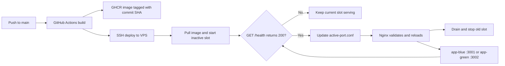

# Universal Zero-Downtime CI/CD Template

Reusable GitHub Actions, GHCR, Docker Compose, and Nginx deployment template for application repositories. Build steps stay in each project's `Dockerfile`; the deployment pipeline uses the same container contract across languages.

## Architecture

The app container listens on port `8080` and must return HTTP 200 from `GET /health` when ready. Compose binds the blue and green slots to loopback ports `3001` and `3002`; Nginx routes to the selected slot. A failed health check leaves the current slot active.

## Quick start

1. Select **Use this template** on GitHub to create a new repository.
2. Replace the sample `Dockerfile` with a multi-stage build for the application. Keep the port `8080` and `/health` contract.
3. Add repository Actions secrets `VPS_HOST`, `VPS_USER`, and `VPS_SSH_KEY`. Set the repository Actions variable `DEPLOY_PATH` to the absolute VPS checkout path, such as `/home/ubuntu/my-app`.
4. Follow [DEPLOYMENT.md](DEPLOYMENT.md) to prepare the VPS, `.env.production`, initial `active-port.conf`, Nginx site, and TLS.
5. Push to `main`. The workflow publishes the commit SHA image to GHCR, then deploys that exact image.

For language-specific Dockerfile examples and the container contract, see [UNIVERSAL_CICD.md](UNIVERSAL_CICD.md).

## Files

- `.github/workflows/deploy.yml`: build, publish, and SSH deployment jobs.
- `docker-compose.yml`: isolated blue and green app slots.
- `scripts/deploy.sh`: health-gated switch, rollback, drain, and scoped image cleanup.
- `nginx.conf`: reverse proxy and upstream port include.
- `DEPLOYMENT.md`: VPS and first-deployment instructions.
# CICD-Automated-Pipeline
# CICD-Automated-Pipeline
